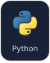
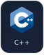
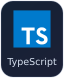
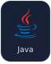
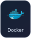

  <a href="https://michaelbaffourawuah.com">
    <picture>
      <source media="(prefers-color-scheme: light)" srcset="./assets/profile-light.svg">
      
    </picture>
  </a>

  <a href="https://michaelbaffourawuah.com"><strong>Explore my portfolio ↗</strong></a> &nbsp;·&nbsp;
  <a href="mailto:michaelbaffourawuah708@gmail.com">Email</a> &nbsp;·&nbsp;
  <a href="https://navox.net">Try NavoX ↗</a>

I'm **Michael**, a **Cornell Engineering** student working on C++ systems, machine learning, and algorithms.

### Selected work

| Project | In brief |
| --- | --- |
| **[Ledger](https://github.com/michaelbawuah/Ledger)** | C++23 limit order book and matching engine: price-time priority, allocation-free order processing, differential tests, and latency studies. |
| **[Gatehaven](https://github.com/michaelbawuah/Gatehaven)** | C++23/SDL3 circuit sandbox with compiled circuit graphs, binary save files, and downloadable previews for macOS, Linux, and Windows. |
| **[NavoX](https://github.com/michaelbawuah/NavoX)** | Personal AI assistant with voice, connected accounts, a Chrome side panel, and OpenAI, Claude, and Gemini adapters. |
| **[Fluxion](https://github.com/michaelbawuah/Fluxion)** | Deep-learning engine from scratch: tensors, autograd, transformers, and native C++/BLAS operators. |
| **[ModelForge](https://github.com/michaelbawuah/ModelForge)** | Model registry and inference platform with versioned artifacts, progressive releases, and rollback. |
| **[ToolRet](https://github.com/michaelbawuah/toolret-hybrid-retrieval)** | Retrieval research on when to rerank, evaluated over 37,292 tools. |
| **[MarketLab](https://github.com/michaelbawuah/MarketLab)** | Portfolio planning and reproducible backtests with exact accounting and independent verification. |
| **[Pro Competitive Programming](https://github.com/michaelbawuah/Pro-Competitive-Programming)** | 835 C++17 reference implementations with algorithm notes, local test fixtures, and reusable data structures. |
| **[LeetCode Atlas](https://github.com/michaelbawuah/LeetCode_Atlas)** | Python and C++ algorithm implementations organized by problem-solving pattern. |

For a closer look at the engineering: [Ledger’s design and trade-offs](https://github.com/michaelbawuah/Ledger/blob/main/docs/design.md), [Gatehaven’s build guide](https://github.com/michaelbawuah/Gatehaven/blob/main/docs/building.md), and [the algorithms collection](https://github.com/michaelbawuah/Pro-Competitive-Programming).

**Working with**

  
  
  
  
  
  
  
  
  

